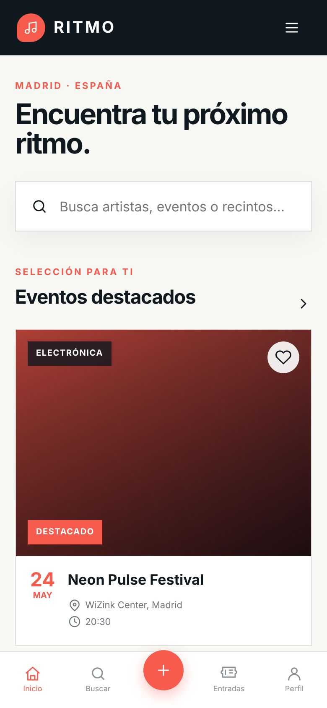
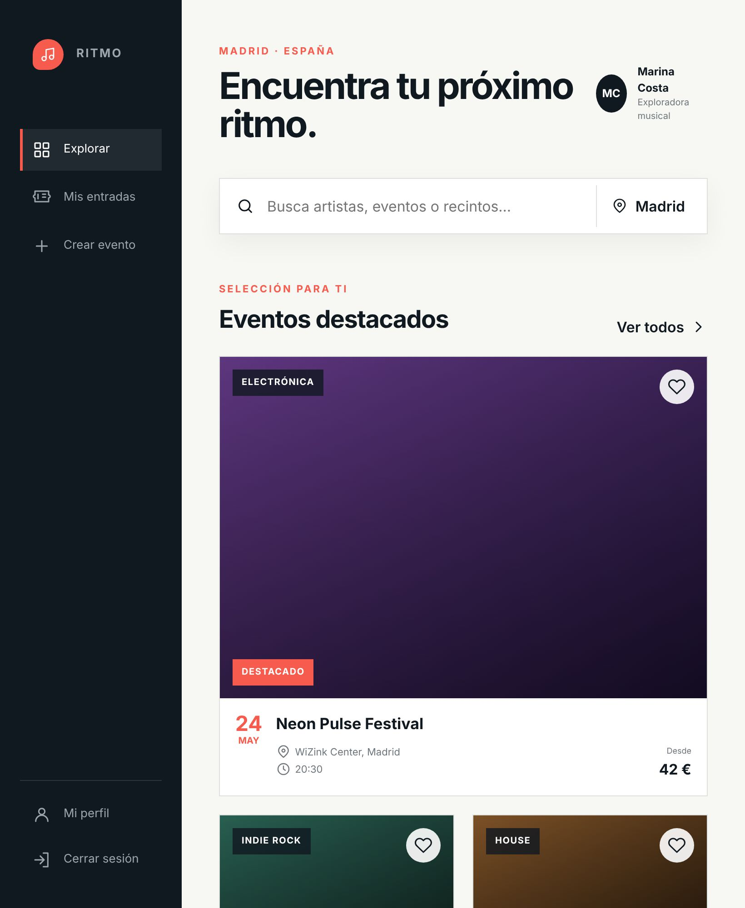
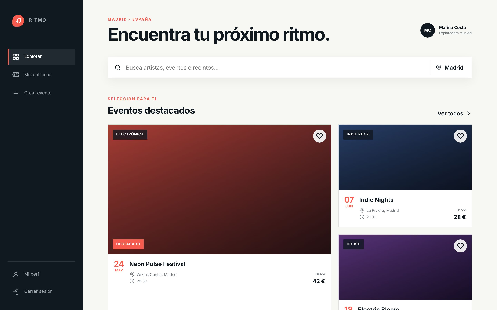
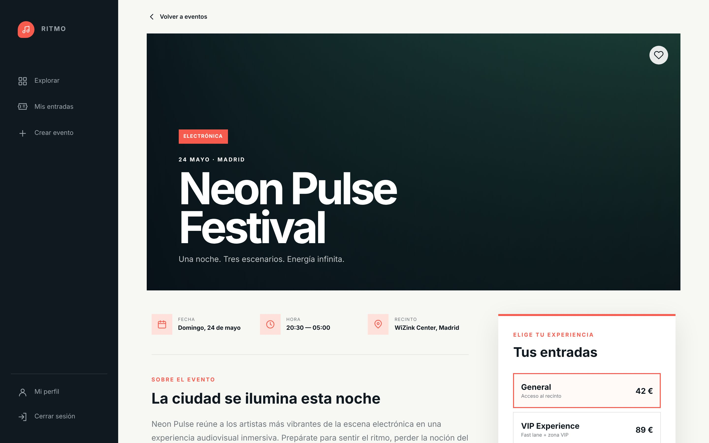
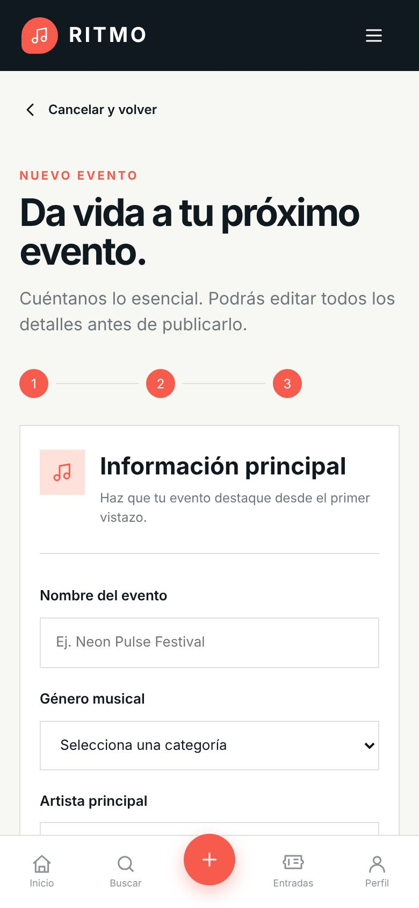
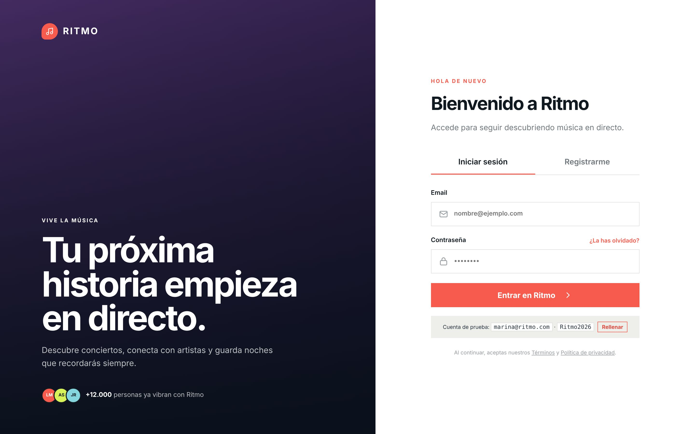

# Ritmo · Memoria técnica del Frontend

**Proyecto 2 · Hito 3 (entrega final)** — Probar, optimizar, desplegar y documentar.

Ritmo es una plataforma para descubrir conciertos y eventos de música en directo. Este documento recoge la arquitectura del frontend (HTML5 + CSS3 + JavaScript ES6+ sin frameworks), las decisiones de maquetación y la lógica JS, y las pruebas y la validación hechas antes de publicar.

## 0. Enlaces de entrega

| Recurso | Enlace |
|---|---|
| Web desplegada | `https://<usuario>.github.io/<repositorio>/` ← **pegar aquí la URL real** |
| Prototipo de Figma (Proyecto 1) | `https://www.figma.com/design/<fileKey>/…` ← **pegar aquí el enlace real** |
| Repositorio de GitHub | `https://github.com/fobos0707/hitoFinal` |
| Tablero Kanban | `https://github.com/users/<usuario>/projects/<n>` ← **pegar aquí la URL real** |

> Cuenta de prueba para la web: `marina@ritmo.com` / `Ritmo2026` (hay un botón «Rellenar» en el login).

---

## 1. Estructura del proyecto

```
ritmo/
├── index.html            Dashboard (tarjetas inyectadas por JS)
├── detalle.html          Ficha dinámica: detalle.html?id=neon-pulse
├── crear.html            Formulario de publicación de eventos
├── login.html            Inicio de sesión
├── registro.html         Registro de usuario
├── 404.html              Página de error para el hosting
├── favicon.svg           Icono de la pestaña
├── css/
│   └── styles.css        Hoja única, organizada en secciones numeradas
├── js/
│   ├── mockData.js       «Base de datos» simulada (arrays de objetos)
│   ├── core.js           Utilidades: DOM (h), formato, localStorage, sesión
│   ├── modal.js          Modales y toasts reutilizables
│   ├── validacion.js     Motor de validación de formularios
│   ├── layout.js         Menú hamburguesa, cerrar sesión, favoritos
│   ├── dashboard.js      Render de tarjetas, buscador y filtros
│   ├── detalle.js        Ficha del evento y compra de entradas
│   ├── crear.js          Formulario de crear evento
│   └── auth.js           Login y registro
├── tests/e2e.js          Pruebas automáticas (Playwright)
├── docs/                 Esta memoria y las capturas
├── .github/workflows/pages.yml   Validación W3C + despliegue en GitHub Pages
├── netlify.toml          Configuración alternativa para Netlify
└── .nojekyll             Evita que GitHub Pages procese los archivos con Jekyll
```

### Decisiones de arquitectura

- **Sin frameworks ni build.** HTML, CSS y JS se sirven tal cual; el despliegue es publicar la carpeta.
- **Scripts clásicos, no módulos ES.** Se cargan con `defer` y cuelgan de un único espacio de nombres `window.Ritmo`. Así la web también funciona abriendo los `.html` con doble clic (`file://`), donde los módulos ES los bloquea CORS. El orden de carga es siempre `mockData → core → modal → (validacion) → layout → script de la página`.
- **Una sola hoja de estilos.** Con unas 700 líneas, una hoja única evita peticiones extra y se mantiene ordenada con secciones numeradas (variables, reset, utilidades, botones, navegación, dashboard, detalle, crear, auth, modal, tablet, escritorio y, al final, los estados interactivos añadidos en el Hito 2, que incluyen su propio bloque `@media (min-width: 701px)` para los componentes nuevos: modales, toasts y buscador).
- **Capa de datos aislada.** `core.js` (`Ritmo.datos.eventos()`) es la única que lee `mockData.js`. Sustituirlo por un `fetch()` a una API real solo afectaría a esa capa.
- **HTML semántico.** `header`, `nav`, `main`, `section`, `article`, `fieldset`, `dl`, `time`, `template`; un solo `h1` visible por página; `lang="es"`; `aria-*` en menú, modales y formularios.

---

## 2. Justificación de la maquetación (Grid / Flexbox) y puntos de ruptura

### 2.1 Enfoque mobile first

La hoja base está escrita para móvil (≈ 390 px) y solo se **amplía** con `@media (min-width: …)`. No hay ninguna consulta `max-width`: lo que no necesita cambiar en pantallas grandes no se redeclara.

| Rango | Consulta | Qué cambia |
|---|---|---|
| **Móvil** (< 701 px) | base, sin consulta | Cabecera con menú hamburguesa + barra inferior de 5 iconos. Tarjetas del Dashboard en **carrusel horizontal** con scroll-snap. Formularios a una columna. Login/registro apilados (imagen arriba). |
| **Tablet** (≥ 701 px) | `@media (min-width: 701px)` | Aparece la **barra lateral fija** de 200 px y desaparecen cabecera y barra inferior. Rejilla de tarjetas a **2 columnas**. Formulario de crear a 2 columnas. Login/registro a **2 columnas** (1.08fr / 0.92fr). Hero de la ficha más alto. |
| **Escritorio** (≥ 1001 px) | `@media (min-width: 1001px)` | Barra lateral a 240 px. Destacados en **1.25fr / 0.75fr**. Rejilla de tarjetas a **3 columnas**. Ficha del evento en `1fr 360px` con el panel de compra **fijo** (`position: sticky`). |

**Por qué 701 y 1001 px.** La barra lateral (200–240 px) necesita que quede espacio útil para el contenido: a 701 px quedan ≈ 500 px, suficientes para dos tarjetas con aire. El segundo corte a 1001 px es donde cabe la tercera columna sin comprimir las tarjetas por debajo de lo legible. El valor 701 se comparte con JS (`matchMedia('(min-width: 701px)')` en `layout.js`) para cerrar el menú móvil al cruzar el umbral; si se cambia, hay que cambiarlo en los dos sitios.

**Otras técnicas de adaptación sin breakpoint:**
- Tipografía fluida con `clamp()`: `--fs-2xl: clamp(2rem, 4vw + .5rem, 3.25rem)` y `--fs-hero: clamp(3.4rem, 7vw, 5.6rem)`.
- Espaciados y colores en **variables CSS** (`:root`), con una escala de 4 px (`--space-1…16`) extraída de la guía de estilos de Figma.
- `prefers-reduced-motion` desactiva transiciones, animaciones y el scroll suave.



*Fig. 1 · Dashboard a 390 px (carrusel + barra inferior).*



*Fig. 2 · Dashboard a 820 px (barra lateral + 2 columnas).*



*Fig. 3 · Dashboard a 1440 px (barra lateral ancha + 1 destacada grande y 2 pequeñas).*

### 2.2 Cuándo Grid y cuándo Flexbox

Criterio: **Grid para estructuras de dos dimensiones** (filas y columnas que deben alinearse entre sí) y **Flexbox para flujos de una dimensión** (una fila o columna de elementos que se reparten el espacio).

| Componente | Técnica | Razón |
|---|---|---|
| Rejilla de eventos `.event-list` | Flex con scroll en móvil → **Grid** `repeat(2,1fr)` → `repeat(3,1fr)` | En móvil es una sola tira desplazable (1D); en tablet/escritorio son columnas de igual ancho (2D). |
| Destacados `.featured-grid` / `.mini-events` | **Grid** `1.25fr 0.75fr` | Dos columnas de proporción distinta; las tarjetas pequeñas se apilan en la columna estrecha. |
| Ficha `.detail-layout` | **Grid** `1fr 360px` | Contenido fluido + panel de compra de ancho fijo. |
| Datos de la ficha `.fact-row` | **Grid** `repeat(3,1fr)` | Tres datos (fecha, hora, recinto) con el mismo ancho. |
| Line-up `.artist-list > li` | **Grid** `30px 50px 1fr auto` | Número, foto, nombre y hora alineados en columnas entre filas. |
| Formulario `.form-grid` | **Grid** `1fr 1fr` | Campos emparejados (género/artista, fecha/hora). |
| Login/registro `.auth-page` | **Grid** `1.08fr 0.92fr` | Panel visual + panel de formulario. |
| Barra inferior `.bottom-nav` | **Grid** `repeat(5,1fr)` | Cinco destinos con el mismo ancho, centrados. |
| Barra lateral `.sidebar` | **Flex** columna, `margin-top: auto` | Empuja «Mi perfil / Cerrar sesión» al fondo. |
| Filtros `.filter-row` | **Flex** con `overflow-x: auto` | Chips en una línea desplazable. |
| Cabecera de sección, total, `.qty`, `.ticket-option` | **Flex** `space-between` | Etiqueta a un lado, valor al otro. |
| Iconos en cajas, avatares, `place-items: center` | **Grid** | Centrado perfecto en ambos ejes con una línea. |

---

## 3. Lógica JavaScript implementada

### 3.1 Validación de formularios (`validacion.js`)

Un motor genérico: cada formulario declara un **esquema** (campo → lista de reglas) y `Ritmo.validacion.conectar()` hace el resto.

- **Sin tooltips nativos:** el `<form>` lleva `novalidate` y el `submit` se intercepta con `preventDefault()`. Los mensajes se crean con `createElement` como `<p class="field__error">` bajo cada control.
- **Tiempo real:** cada campo escucha `input`, `change` y `blur`. Mientras está vacío y sin tocar no se muestra nada; al escribir o salir del campo se pinta en rojo (con mensaje) o en verde.
- **Una regla = una función** `(valor, elemento, formulario) => '' | 'mensaje'`. Se evalúan en orden y gana el primer error, así el mensaje siempre es el más específico.
- **Validaciones cruzadas:** al cambiar la fecha del evento se revalidan la hora y la fecha de inicio de venta.
- **Envío:** se validan todos los campos, se muestra un resumen («Hay 10 campos que corregir…») y el foco va al primer campo inválido.
- **Accesibilidad:** `aria-invalid`, `aria-describedby` apuntando al error y `aria-live="polite"`.

Reglas por tipo: texto (obligatorio, longitud mínima/máxima, nombre y apellido), email (formato y, en el registro, que no exista), contraseña (login ≥ 6; registro ≥ 8 con mayúscula, minúscula, número y sin espacios), fechas (no pasadas; inicio de venta ≤ evento; `validity.badInput` para fechas incompletas), hora (posterior a la actual si es hoy), números (precio 0–5000 con máx. 2 decimales; cantidad entera 1–100 000) y selects (opción por defecto deshabilitada = obligatorio).

```js
// js/auth.js · esquema del registro
R.validacion.conectar(form, {
  nombre:   { reglas: [V.requerido('Escribe tu nombre completo.'), V.nombreCompleto(), V.maxLen(60)] },
  email:    { reglas: [V.requerido(), V.email(),
              V.personalizada(v => !R.sesion.emailExiste(v), 'Ya existe una cuenta con este email.')] },
  password: { reglas: [V.requerido(), V.password({ min: 8 })] }
}, { onValido: function (datos, ui) { /* crear la cuenta */ } });
```

### 3.2 Renderizado dinámico del DOM

Los datos viven en `mockData.js` (cuatro «tablas»: `usuarios`, `categorias`, `recintos`, `eventos`) y `core.js` los une con lo que el usuario ha creado (`localStorage`) y añade campos derivados (recinto completo, «precio desde», enlace a la ficha).

| Técnica | Uso |
|---|---|
| `<template>` + `cloneNode(true)` | Tarjeta de evento (`#tpl-evento`), ficha (`#tpl-detalle`) y fila del line-up (`#tpl-artista`). Se rellenan los huecos marcados con `data-campo`. |
| `createElement` (función `h()`) | Chips de filtro, opciones de entrada y cantidad, modales, errores de campo y toasts. |
| `innerHTML` | Solo para los iconos SVG propios del proyecto (cadenas constantes). **Nunca** con datos del usuario. |

**Seguridad (XSS):** todo texto procedente de datos (título, artista, descripción…) se inserta con `textContent`. Importa porque los eventos creados por el usuario se guardan y se vuelven a pintar.

Flujos principales:
- **Dashboard (`dashboard.js`):** pinta destacados y rejilla; el buscador reacciona a `input`, ignora tildes y mayúsculas (`normalize('NFD')`), combina varias palabras con «y» y se combina con los chips de género; contador con `aria-live` y estado «sin resultados» con botón «Limpiar filtros».
- **Ficha (`detalle.js`):** `detalle.html?id=…` pinta hero, datos, line-up y panel de compra. El total se calcula en JS (`precio × cantidad`) y la cantidad se limita al stock restante; al agotarse, el tipo queda deshabilitado. Un `id` desconocido muestra «evento no encontrado».
- **Crear evento (`crear.js`):** valida, muestra un modal-resumen, guarda en `localStorage` y el evento aparece en el Dashboard y en su ficha.
- **Menú, modales y toasts (`layout.js`, `modal.js`):** menú con `aria-expanded`, cierre con Esc / clic fuera / cambio de breakpoint; `Ritmo.modal.confirmar()` devuelve una `Promise<boolean>`, con foco atrapado (Tab/Shift+Tab), scroll bloqueado y foco devuelto al cerrar.
- **Persistencia:** todo pasa por `Ritmo.almacen` (envuelve `localStorage` en `try/catch`, por si está bloqueado) con claves `ritmo.sesion`, `ritmo.usuarios`, `ritmo.eventosCreados`, `ritmo.favoritos`, `ritmo.ventas`, `ritmo.compras`.



*Fig. 4 · Ficha dinámica renderizada desde `?id=neon-pulse`.*



*Fig. 5 · Formulario de crear evento a 390 px.*



*Fig. 6 · Login en escritorio (dos columnas).*

---

## 4. Fidelidad del desarrollo respecto a Figma

Para comprobar la fidelidad, abrir en paralelo el prototipo de Figma (sección 0) y la web desplegada, a los mismos anchos que usan los *frames* de Figma.

| Pantalla | Frame de Figma | Ruta en la web | Verificación |
|---|---|---|---|
| Dashboard | ☐ enlace al frame | `index.html` | ☐ 390 px · ☐ 820 px · ☐ 1440 px |
| Ficha de evento | ☐ enlace al frame | `detalle.html?id=neon-pulse` | ☐ 390 px · ☐ 1440 px |
| Crear evento | ☐ enlace al frame | `crear.html` | ☐ 390 px · ☐ 1440 px |
| Login | ☐ enlace al frame | `login.html` | ☐ 390 px · ☐ 1440 px |
| Registro | ☐ enlace al frame | `registro.html` | ☐ 390 px · ☐ 1440 px |

Elementos del diseño que se han trasladado como variables CSS: la paleta (tinta `#101820`, coral `#f65b4e`, papel `#f7f7f3`, lima `#d8f35a`, cielo `#85d5de`), la tipografía (DM Sans para texto y Space Grotesk para titulares), la escala de espaciados de 4 px y los radios/sombras.

**Diferencias conocidas respecto al diseño:**
- El día de la semana de la ficha se calcula de la fecha real (24/05/2026 es **domingo**); Figma decía «sábado».
- Las fotos de los eventos son de Unsplash; si una no carga, la tarjeta degrada a un fondo oscuro, sin icono de imagen rota.
- «Mis entradas» y «Mi perfil» siguen sin destino, como en el diseño del Hito 1 (las compras ya se registran para mostrarlas en una ampliación).

---

## 5. Pruebas, validación y optimización

### 5.1 Validación W3C

Se ha pasado el **Nu Html Checker oficial del W3C** (`vnu.jar`, el motor de validator.w3.org) sobre las 6 páginas HTML y `styles.css`:

```bash
java -jar vnu.jar --also-check-css *.html css/styles.css
```

Resultado final: **0 errores y 0 avisos**.

Como el HTML estático no incluye las tarjetas (las pinta JS), también se validó el **DOM ya renderizado** (`document.documentElement.outerHTML` tras ejecutar los scripts) de Dashboard, ficha, crear, login y registro: **0 errores** (solo un aviso informativo del propio validador sobre tener dos `<h1>`, uno de ellos en el estado «no encontrado», que está oculto cuando hay evento).

### 5.2 Consola del navegador

Con Playwright (Chromium) se cargó cada página en 3 anchos (390, 820 y 1440 px) y se escucharon `console` (error/warning), `pageerror` y `requestfailed`. Resultado: **0 errores y 0 avisos**, y sin desbordamiento horizontal en ningún ancho. Las pruebas se ejecutan también por HTTP (no solo `file://`) para reproducir el hosting real.

### 5.3 Pruebas funcionales automáticas

`tests/e2e.js` ejecuta **21 comprobaciones** y falla si aparece cualquier error de consola o respuesta HTTP ≥ 400 de la propia web: renderizado de 9 tarjetas y 3 destacados, buscador sin tildes, estado vacío, filtros combinados, favoritos, menú móvil (abrir/Esc), validación de login/registro/crear con foco al primer error, ficha dinámica, modal de compra y `id` desconocido.

```bash
npx http-server -p 8099 -s &
node tests/e2e.js          # 21 comprobaciones OK, 0 errores de consola
```

### 5.4 Fallos encontrados y corregidos en esta fase

| # | Hallazgo | Cómo se detectó | Corrección |
|---|---|---|---|
| 1 | **Desbordamiento horizontal de 26 px en móvil** (390 px) en el Dashboard: aparecía scroll lateral de toda la página. | Test de `scrollWidth > clientWidth` | Los `<input class="visually-hidden">` (posición absoluta) de los chips escapaban del contenedor con scroll al no ser su `label` `position: relative`. Se añadió `position: relative` a `.chip`. |
| 2 | **2 errores W3C:** `<time>` vacío en las plantillas (`index.html`, `detalle.html`). | Nu Html Checker | Valor por defecto `datetime="00:00"`; además `detalle.js` actualiza el `datetime` en cada artista del line-up. |
| 3 | **Errores W3C solo visibles en el DOM renderizado:** lista `<dl>` de la ficha con `<div>` y `<span>` no permitidos. | Validar el DOM tras ejecutar JS | Se sustituyó por `<ul>`/`<li>` con `.fact__label` y `.fact__value`. Apariencia idéntica. |
| 4 | **404 en consola en producción:** el navegador pide `/favicon.ico` y no existía. | Servir por HTTP y revisar respuestas | Se añadió `favicon.svg` y `<link rel="icon">` en las 5 páginas. |

### 5.5 Optimización

| Medida | Detalle |
|---|---|
| Peso | HTML 1–14 kB por página; CSS 34 kB (**7,7 kB** con gzip); JS 70 kB en 9 archivos (**≈ 20 kB** con gzip). Sin dependencias ni librerías. |
| Carga de scripts | `defer` en todos: no bloquean el renderizado. |
| Imágenes | `loading="lazy"` en las tarjetas del Dashboard y en las fotos del line-up; si una imagen falla, se retira (sin icono roto). |
| Fuentes | `preconnect` a Google Fonts y `display=swap` (texto visible mientras carga la fuente) con *fallback* a `system-ui`. |
| Accesibilidad de movimiento | `prefers-reduced-motion` desactiva transiciones, animaciones (`@keyframes` de modales y menú) y scroll suave. |
| SEO / compartir | `<title>` y `<meta name="description">` por página, `theme-color`, favicon. |
| Hosting | `404.html` propia; `.nojekyll`; cabeceras de seguridad y caché en `netlify.toml`. |

> **Pendiente de medir en producción:** una auditoría de **Lighthouse** sobre la URL desplegada (Chrome DevTools → Lighthouse). No se ha ejecutado aquí porque las fuentes e imágenes externas dependen de la red. Anotar las puntuaciones en la tabla de abajo.

| Categoría | Móvil | Escritorio |
|---|---|---|
| Rendimiento | _ | _ |
| Accesibilidad | _ | _ |
| Buenas prácticas | _ | _ |
| SEO | _ | _ |

---

## 6. Despliegue

### Opción A · GitHub Pages (incluida en el repositorio)

1. Crear el repositorio en GitHub y subir el código (`git push -u origin main`).
2. En **Settings → Pages → Build and deployment → Source**, elegir **GitHub Actions**.
3. El flujo `.github/workflows/pages.yml` se ejecuta en cada *push* a `main`: primero **valida HTML y CSS con el validador W3C** (si hay un error, no se publica) y después despliega.
4. La URL queda como `https://<usuario>.github.io/<repositorio>/`. Todas las rutas del proyecto son **relativas**, así que funciona en la subcarpeta del repositorio.

### Opción B · Netlify

Arrastrar la carpeta del proyecto a <https://app.netlify.com/drop>, o conectar el repositorio (`netlify.toml` ya indica `publish = "."`).

### Comprobación posterior al despliegue

- [ ] Abrir la URL en una ventana de incógnito y comprobar que la consola (F12) está vacía en las 5 páginas.
- [ ] Probar el flujo completo: login → buscar → abrir ficha → comprar → crear evento.
- [ ] Probar en móvil real o con el modo dispositivo de DevTools.
- [ ] Pasar Lighthouse y rellenar la tabla de la sección 5.5.

---

## 7. Control de versiones y Kanban

El repositorio sigue **commits convencionales** (`feat`, `fix`, `refactor`, `test`, `ci`, `docs`, `chore`) con ámbito por hito y área, de forma que el historial se lee como el avance del proyecto: Hito 1 (HTML y CSS) → Hito 2 (datos, validación, render, componentes) → Hito 3 (pruebas, correcciones, despliegue y documentación).

El tablero Kanban (GitHub Projects) tiene las columnas **Pendiente → En curso → Completado**; las tarjetas sugeridas para cada sesión están en [`KANBAN.md`](../KANBAN.md).

---

## 8. Decisiones y limitaciones

- **Sin backend:** sesión, stock y compras viven en `localStorage` de cada navegador; no hay envío real de emails ni pasarela de pago.
- **Contraseñas en claro en `localStorage`:** aceptable solo porque es una simulación. En un proyecto real se enviarían al servidor por HTTPS y se guardarían con *hash*.
- **Datos simulados:** `mockData.js` es una propuesta coherente con la app; si la base de datos del Proyecto 1 usa otros nombres de tablas o campos, solo hay que adaptar ese archivo y `Ritmo.datos.enriquecer()`.
- **Dependencias externas:** fotos (Unsplash) y fuentes (Google Fonts). La web sigue siendo usable si no cargan.
- **Reiniciar la demo:** en la consola del navegador,
  `Object.keys(localStorage).filter(k => k.startsWith('ritmo.')).forEach(k => localStorage.removeItem(k))`.
